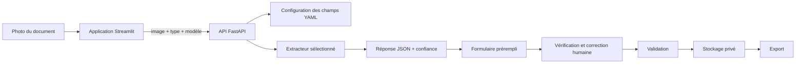

# Architecture

## Flux nominal

## Composants

- `api/config/document_types/` décrit les types et les champs attendus. Ajouter un nouveau document consiste à ajouter un fichier de configuration.
- `api/services/field_loader.py` charge la configuration; `extractor.py` sélectionne le modèle.
- `api/models/` contient l'interface commune et les adaptateurs Qwen-VL et PaddleOCR-VL. Les implémentations sont des stubs factices pour le moment.
- `app/` envoie l'image et le choix de modèle à l'API, puis laisse l'utilisateur vérifier les valeurs et les champs signalés.
- `eval/` accueillera les images anonymisées, les réponses de référence et les scripts de comparaison.
- `storage/` est réservé aux documents validés et ne doit jamais être commité.

Les champs dont la confiance est inférieure au seuil configurable `LOW_CONFIDENCE_THRESHOLD` sont retournés dans `low_confidence_fields`. Le seuil par défaut est `0.7`.
